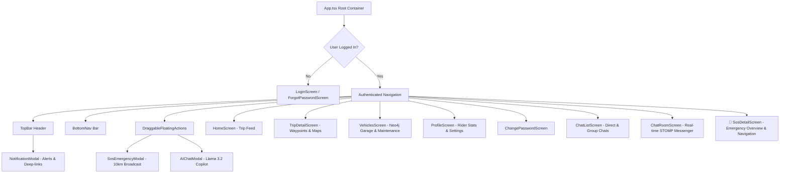

# 📱 WayMate Client (Mobile & Web App)

[](https://reactnative.dev/)
[](https://expo.dev/)
[](https://www.typescriptlang.org/)
[](LICENSE)

> The front-end mobile and web application for **WayMate**, delivering an ultra-modern, aesthetic experience inspired by **BMW M Motorsport** and the **BMW S1000RR**. Built with React Native, Expo SDK 58, and TypeScript.

---

## 🧭 Table of Contents

- [✨ Visual Aesthetics & Design System](#-visual-aesthetics--design-system)
- [📱 Screen Architecture](#-screen-architecture)
- [🚀 Key Modules & Capabilities](#-key-modules--capabilities)
- [📂 Project Directory Structure](#-project-directory-structure)
- [🛠️ Installation & Getting Started](#️-installation--getting-started)
- [⚙️ Environment Configuration](#️-environment-configuration)
- [📡 Services & State Management](#-services--state-management)
- [🗺️ Google Maps Navigation Integration](#️-google-maps-navigation-integration)
- [🔔 Push Notifications & Native Channels](#-push-notifications--native-channels)
- [🧪 Quality Assurance & Type Checking](#-quality-assurance--type-checking)

---

## ✨ Visual Aesthetics & Design System

WayMate Client is engineered to **WOW** riders at first glance with motorsport-grade UI excellence:
- **BMW M Color Palette**:
  - `M Blue`: `#00A3E0` (Electric Cyan)
  - `M Navy`: `#002663` (Deep Track Navy)
  - `M Red`: `#E20613` (High-Rev Red)
- **Ambient Glow Background**: Dynamic glowing blurred spheres positioned in background coordinates, creating a sleek futuristic vibe.
- **Glassmorphism**: Translucent card surfaces (`rgba(255, 255, 255, 0.05)` dark / elevated surface light) with crisp border highlights.
- **Micro-Animations**: Spring toasts, collapsible floating action buttons, live pulse pills for active emergencies, and smooth tab transitions.
- **Bilingual & Adaptive Units**: Instant English (ENG) / Vietnamese (VIE) translations and Kilometers (KM) / Miles (MI) unit switching.

---

## 📱 Screen Architecture



---

## 🚀 Key Modules & Capabilities

### 1. 🛣️ Adventure Feed & Scenic Passes (`HomeScreen`, `TripDetailScreen`)
- Browse curated motorcycle routes across Vietnam:
  - **Hà Giang Northern Loop** (Mã Pí Lèng, Đồng Văn, Du Già).
  - **Sài Gòn - Đà Lạt** (Đèo Bảo Lộc, Đèo Prenn, Highway 20).
  - **National Highway 1 Coastal Run** (Đèo Hải Vân, Nha Trang, Quy Nhơn).
- View distance, duration, elevation, road conditions, homestays, and petrol stops.
- Launch turn-by-turn routes in **Google Maps**.

### 2. 🏍️ Digital Garage & Maintenance Tracker (`VehiclesScreen`)
- Manage motorcycles and cars connected to the **Neo4j Graph Database**.
- Live Odometer (ODO) tracker with progress bars towards periodic milestones:
  - **Engine Oil Replacement**: 3,000 km (motorcycles) / 5,000 km (cars).
  - **Drive Chain Clean & Lube**: 800 km.
  - **Brake Pads & Fluid**: 10,000 km.
  - **Tyres & Spark Plugs**: 15,000 km.
- Proactive health status: `GOOD` (green), `DUE SOON` (amber), or `OVERDUE` (red).
- Complete service history logs with workshop notes and pricing.

### 3. 🚨 10km Emergency SOS Roadside Assistance (`SosDetailScreen`, `SosEmergencyModal`)
- One-tap emergency broadcast for flat tyres, battery failure, running out of petrol, snapped chains, or accidents.
- Nearby community dispatch within **10 km radius**.
- **SOS Details Page** displays:
  - **Rider Profile**: Avatar, name, and direct **"Call Phone"** button (`tel:`).
  - **Motorcycle Details**: Brand, model, license plate number, and situation description.
  - **GPS Navigation**: Coordinates and one-tap **"Open in Google Maps"** navigation.
  - **Assistance Status**: Coordinate help with `I Am On My Way To Help` and `Mark as Resolved`.

### 4. 💬 Real-Time Messenger (`ChatListScreen`, `ChatRoomScreen`)
- Full-duplex WebSocket messaging via Spring Boot STOMP.
- 1-on-1 direct rider chats and multi-rider convoy groups.
- Message types: Text, photos, shared GPS locations with Google Maps links, and trip cards.
- Live unread badges on the bottom tab bar and bold styling for unread rooms.

### 5. 🤖 AI Adventure Copilot (`AIChatModal`)
- Movable, collapsible floating button with upward animation.
- Instant access to the local **Llama 3.2 1B** AI Agent.
- Provides road condition advice, weather precautions, mechanical troubleshooting, and route recommendations.

---

## 📂 Project Directory Structure

```
waymate-client/
├── App.tsx                          # Root container, global routing & notification deep-links
├── index.ts                         # Application entry point
├── package.json                     # Dependencies & Expo scripts
├── tsconfig.json                    # TypeScript strict compiler options
├── src/
│   ├── components/
│   │   ├── AIChatModal.tsx          # Fullscreen AI assistant modal
│   │   ├── BottomNav.tsx            # Floating bottom navigation bar with chat badges
│   │   ├── DraggableFloatingActions.tsx # Draggable & collapsible SOS + AI action buttons
│   │   ├── LaunchLoadingScreen.tsx  # BMW M splash screen animation
│   │   ├── NotificationModal.tsx    # Notification center modal (SOS & social alerts)
│   │   ├── SosEmergencyModal.tsx    # SOS emergency broadcast form
│   │   ├── TopBar.tsx               # Adaptive header (theme, unit switch, GPS, back button)
│   │   └── WaymateIcon.tsx          # Custom SVG WayMate logo
│   ├── config/
│   │   └── api.ts                   # Centralized API, WebSocket, and AI Agent URLs
│   ├── context/
│   │   ├── LanguageContext.tsx      # Bilingual ENG / VIE translations & KM / MI unit state
│   │   ├── LocationContext.tsx      # Expo Location GPS coordinates and permission state
│   │   └── ThemeContext.tsx         # Dark / Light theme tokens and BMW M gradients
│   ├── data/
│   │   ├── mockTrips.ts             # Curated adventure route definitions & waypoints
│   │   └── mockVehicles.ts          # Vehicle types and default maintenance schedules
│   ├── i18n/
│   │   └── translations.ts          # Comprehensive English & Vietnamese dictionary
│   ├── screens/
│   │   ├── ChangePasswordScreen.tsx # Secure password update form
│   │   ├── ChatListScreen.tsx       # Conversation rooms list with real-time unread badges
│   │   ├── ChatRoomScreen.tsx       # Real-time chat messages, photo/location attachments
│   │   ├── ForgotPasswordScreen.tsx # Email reset token verification flow
│   │   ├── HomeScreen.tsx           # Main adventure feed and trip cards
│   │   ├── LoginScreen.tsx          # User sign-in, sign-up, and Google OAuth2
│   │   ├── ProfileScreen.tsx        # Rider bio, garage summary, and settings
│   │   ├── SosDetailScreen.tsx      # 🚨 Emergency details, phone call, and Google Maps
│   │   ├── TripDetailScreen.tsx     # Scenic pass elevation, lodging, and route guide
│   │   └── VehiclesScreen.tsx       # Neo4j motorcycle garage and maintenance tracker
│   ├── services/
│   │   ├── authApi.ts               # Signin, signup, Google OAuth, and JWT session handling
│   │   ├── chatApi.ts               # Chat room creation, message history, unread counters
│   │   ├── chatWs.ts                # WebSocket client for real-time STOMP messaging
│   │   ├── notificationService.ts   # Expo notification channels, local push, read sync
│   │   ├── sosApi.ts                # SOS dispatch, status progression, and fetch by ID
│   │   └── vehicleApi.ts            # Neo4j vehicle CRUD and maintenance record APIs
│   └── utils/
│       └── mapUtils.ts              # Robust Google Maps deep-link and coordinate launcher
```

---

## 🛠️ Installation & Getting Started

### Option A: Run via Docker (Expo Web on Port 8782)
```bash
# Stand at /waymate or /waymate/waymate-client
docker build -t waymate-client:latest .

# Run container on port 8782
docker run -d \
  --name waymate-client \
  -p 8782:8782 \
  waymate-client:latest
```
Access in browser: `http://localhost:8782`

---

### Option B: Local Development (Mobile & Web)

### Prerequisites
- **Node.js**: v18.0.0 or higher
- **npm** or **yarn**
- **Expo Go** app installed on your physical mobile device (or Android Studio / Xcode simulator)

### 1. Install Dependencies
```bash
cd waymate-client
npm install
```

### 2. Start Metro Bundler
```bash
# Start Expo development server on port 8782 with cache cleared
npm run start:clear
```

### 3. Open Application
- **Android Emulator**: Press `a` in the terminal.
- **Web Browser**: Press `w` in the terminal.
- **Physical Device**: Open the **Expo Go** app and scan the terminal QR code.

---

## ⚙️ Environment Configuration

Configure connection endpoints in [`src/config/api.ts`](file:///d:/waymate/waymate-client/src/config/api.ts) or via `.env`:

```env
# URL of waymate-service (Spring Boot backend)
EXPO_PUBLIC_API_URL=http://localhost:8781

# URL of waymate-agent (FastAPI AI Agent)
EXPO_PUBLIC_AI_AGENT_URL=http://localhost:8000
```

> **Note for Android Physical Devices / Emulators**: When running on an Android physical device via Expo Go, replace `localhost` with your machine's local Wi-Fi IP address (e.g., `http://192.168.x.x:8781`) so the device can reach the backend services.

---

## 📡 Services & State Management

| Service | File | Purpose |
| :--- | :--- | :--- |
| **Authentication** | [`authApi.ts`](file:///d:/waymate/waymate-client/src/services/authApi.ts) | Signin, signup, JWT token persistence, and Google OAuth2 integration. |
| **Chat & WebSocket** | [`chatWs.ts`](file:///d:/waymate/waymate-client/src/services/chatWs.ts) | Real-time WebSocket connection handling incoming messages and room subscriptions. |
| **SOS Emergencies** | [`sosApi.ts`](file:///d:/waymate/waymate-client/src/services/sosApi.ts) | Dispatches 10km radius SOS alerts and updates emergency status (`HELPING` / `RESOLVED`). |
| **Notifications** | [`notificationService.ts`](file:///d:/waymate/waymate-client/src/services/notificationService.ts) | Manages Android notification channels (`emergency-sos`, `chat-messages`), local push alerts, and unread badges. |
| **Vehicle Telemetry** | [`vehicleApi.ts`](file:///d:/waymate/waymate-client/src/services/vehicleApi.ts) | Communicates with Spring Data Neo4j to manage vehicles and maintenance logs. |

---

## 🗺️ Google Maps Navigation Integration

The utility [`src/utils/mapUtils.ts`](file:///d:/waymate/waymate-client/src/utils/mapUtils.ts) provides reliable turn-by-turn navigation across Android, iOS, and Web:
- **Native Geo URI**: Attempts to open `geo:lat,lng?q=lat,lng(Label)` directly in the installed Google Maps app.
- **Web URL Fallback**: Automatically falls back to `https://www.google.com/maps/search/?api=1&query=lat,lng` if native intents are unavailable.
- **Polymorphic Safety**: Protects against non-string inputs to guarantee zero crash runtime stability.

---

## 🔔 Push Notifications & Native Channels

Configured with high-priority Android notification channels:
1. `emergency-sos`: Max priority, urgent vibration pattern `[0, 500, 250, 500]`, red LED indicator.
2. `chat-messages`: High priority, green LED, message preview with sender avatar.
3. `social-alerts`: Post reactions, comments, and community shares.

Clicking any SOS notification immediately deep-links into the **SOS Details Screen** with all vehicle and emergency information.

---

## 🧪 Quality Assurance & Type Checking

WayMate Client adheres to strict TypeScript standards:
```bash
# Verify type safety across all components and screens
npx tsc --noEmit
```

---

## 📄 License

MIT License. Designed and crafted with ❤️ for adventure riders.
